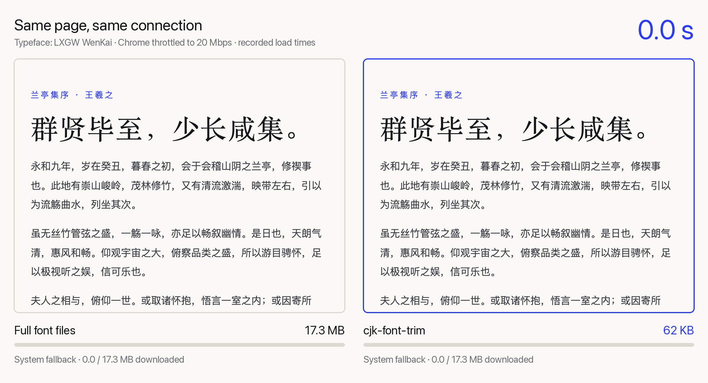
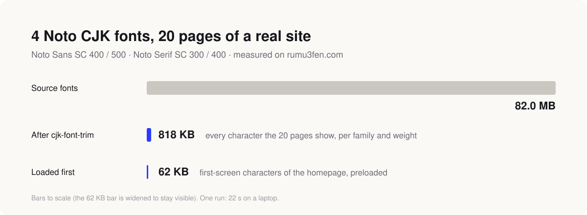
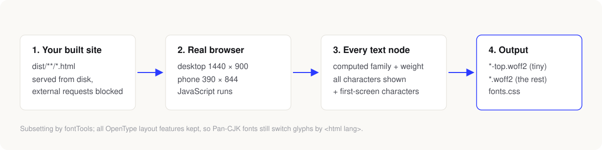
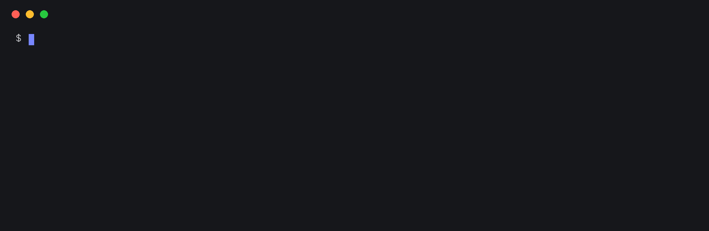

<h1 align="center">cjk-font-trim</h1>

<p align="center">
  <b>日本語・中国語・韓国語の Web フォントを、20 MB から数百 KB に。</b><br>
  サイトに実際に表示される文字だけでサブセット化し、ファーストビューの文字を先に読み込みます。
</p>

<p align="center">
  <a href="LICENSE"></a>
  
  
  
</p>

<p align="center"><a href="README.md">English</a> · <a href="README.zh-CN.md">简体中文</a> · <b>日本語</b></p>

<p align="center"><br><sub>同じページ・同じ帯域制限（Chrome、20 Mbps）。左は LXGW WenKai（霞鹜文楷）をそのまま配信（17.3 MB）、右は cjk-font-trim の出力。読み込み時間は実測で、最終的な表示はピクセル単位で同一です。</sub></p>

## 課題

欧文の Web フォントは 20〜50 KB 程度ですが、和文フォントは数万グリフを持ち、**1 ウェイトで 16〜25 MB** あります。よくある選択肢はどれも決め手に欠けます。

- **フォントをそのまま配信する**：20 MB の読み込みを待つ人はいません。
- **Google Fonts を使う**：1 ウェイトが約 100 個の `unicode-range` に分割され、1 ページで何十ものフォントリクエストが発生します。中国本土からは利用できません。
- **システムフォントで妥協する**：選び抜いた書体が、デザイナーの PC でしか表示されません。

一方で、1 ページに実際に表示される文字は数百字程度、コーポレートサイト全体でも 2,000 字に収まることがよくあります。

<p align="center"></p>

## できること

1. **ビルド済みサイトの全ページを実ブラウザで開きます**。デスクトップとスマートフォンの 2 つの幅で、JavaScript も実行した状態です。
2. **すべてのテキストノードの算出フォントを読み取り**、どの文字がどのファミリー・どのウェイトで表示されているかを把握します。非表示の要素や、HTML にあっても描画されない文字は含めません。
3. **ファミリー・ウェイトごとに `.woff2` を 2 つ出力します**。読み込み直後に見える文字だけの小さな**ファーストビュー用**ファイルと、それ以外の文字のファイルです。
4. **`fonts.css` を生成します**。ファーストビュー用ファイルは `unicode-range` 付きで最後に宣言されるため、ブラウザは十数〜数十 KB を取得した時点で、ファーストビューを正しい書体で描画できます。残りはその後に読み込まれます。

<p align="center"></p>

## 向いているケース

**向いている**

- 静的サイト・プリレンダリングされたサイト：コーポレートサイト、ポートフォリオ、ドキュメント、ブログ、LP（Astro、Next.js の静的出力、Hugo、Eleventy、Vite、手書き HTML など）
- 指定の和文書体（Noto Serif JP、源ノ明朝、ライセンスを購入したブランドフォント）をすべての訪問者に表示したい
- 中国本土の訪問者がいて、Google Fonts が使えない
- 多言語サイト：言語ごとに 1 回ずつ実行します

**向いていない**

- ビルド時に内容がわからないテキスト：コメント、ユーザー名、検索ボックス、公開後に CMS で編集する内容。サブセットにない文字は、フォントスタックの次のフォントで表示されます。この場合は、フォント全体を順序付きのチャンクに分割する [cn-font-split](https://github.com/KonghaYao/cn-font-split) が適しています。
- サブセット化やセルフホストがライセンスで禁止されているフォント（Noto CJK、源ノ系、多くの OFL フォントはどちらも許可されています）。

## クイックスタート

```bash
git clone https://github.com/rumu3fen-dev/cjk-font-trim && cd cjk-font-trim
pip install -r requirements.txt    # fontTools + brotli
npm install                        # Playwright
npx playwright install chromium    # またはインストール済みの Google Chrome を使う場合は --chrome
```

まずは同梱の 1 ページの[サンプル](example/)で試せます。

<p align="center"></p>

サイトをビルドしてから、出力フォルダと元のフォントを指定します。

```bash
python3 cjk_font_trim.py --site ../my-site/dist --out ../my-site/dist/fonts --url /fonts/ \
  --font "Noto Sans JP:400=fonts/NotoSansCJKjp-Regular.otf" \
  --font "Noto Sans JP:700=fonts/NotoSansCJKjp-Bold.otf" \
  --font "Noto Serif JP:300=fonts/NotoSerifCJKjp-Light.otf"
```

あとは既存の `@font-face` を生成された `fonts.css` に置き換え、ファーストビュー用ファイルを preload します。

```html
<link rel="stylesheet" href="/fonts/fonts.css">
<link rel="preload" href="/fonts/noto-sans-jp-400-top.woff2" as="font" type="font/woff2" crossorigin>
```

CSS はそのままで構いません。`font-family: "Noto Sans JP", sans-serif` がサブセット化されたファイルを使うようになります。テキストを変更したら再実行してください。ビルドの最後のステップに入れられる程度の速さです。

## オプション

| オプション | 説明 |
|---|---|
| `--site DIR` | ビルド済みサイトのフォルダ（必須） |
| `--font "FAMILY:WEIGHT=FILE"` | ファミリー・ウェイトごとに 1 つ（必須、複数指定可）。`FAMILY` は CSS の `font-family` に書いた名前で、フォントスタックのどこにあっても構いません。`.otf`、`.ttf`、`.woff2` に対応 |
| `--out DIR` | `.woff2` と `fonts.css` の出力先（必須） |
| `--url PREFIX` | ブラウザがフォントを読み込む URL（既定値 `/fonts/`） |
| `--pages / /about/ …` | スキャンするページ（既定値：`--site` 内のすべての `.html`） |
| `--top-pages / …` | ファーストビューを小さな `*-top` ファイルに入れるページ（既定値：`/`。スキャン対象にない場合は最初のページ）。他のページの文字もフルのファイルには含まれます |
| `--top-exclude "figure,.demo"` | ファーストビュー内でもフルのファイルを待ってよい要素（アニメーション、長い段落など）。`*-top` を小さく保てます |
| `--chrome` | Playwright の Chromium ではなく、インストール済みの Google Chrome を使う |

算出されたウェイトは、指定したウェイトのうち最も近いものにまとめられます（`font-weight: 450` は 400 か 500 へ）。

## 他のツールとの比較

どれも優れたツールで、それぞれ隣り合う課題を解決しています。

| ツール | 使用文字の調べ方 | 向いている用途 |
|---|---|---|
| **cjk-font-trim** | ビルド済みページを実ブラウザで描画（デスクトップ + スマホ） | ウェイト別のファイルと、独立したファーストビュー用ファイルがほしい静的 CJK サイト |
| [glyphhanger](https://github.com/zachleat/glyphhanger) | ヘッドレスブラウザで URL をクロール | `unicode-range` の使用状況の分析と、欧文を中心としたフォントのサブセット化 |
| [subfont](https://github.com/Munter/subfont) | HTML/CSS からフォントを追跡して書き換え | Google Fonts のセルフホスト化や preload の挿入も行うビルドステップ |
| [font-spider 字蛛](https://github.com/aui/font-spider) | ローカルの HTML と CSS を静的解析 | テキストがすべて HTML ソースにある中国語ページ |
| [cn-font-split](https://github.com/KonghaYao/cn-font-split) | 調べない：フォント全体を順序付きで分割 | ビルド時に内容がわからないテキスト。どの文字でも表示できる |

ファーストビュー用ファイルを独立して出力するのは cjk-font-trim だけです。ファーストビューがほぼ即座に正しい書体で表示されるのは、このためです。

## よくある質問

**日本語・韓国語・繁体字にも使えますか？** はい。対応するフォント（`Noto Sans JP`、`Noto Sans KR`、`Noto Sans TC` など）を指定してください。Noto Sans CJK のような汎 CJK フォントは、OpenType の `locl` によって `<html lang>` に応じて字形を切り替えます。レイアウト機能はすべて保持されるので、1 つの元フォントで複数の言語に対応できます。多言語サイトでは、言語ごとにページと出力フォルダを分けて実行してください。

**サブセットにない文字はどうなりますか？** その文字だけ `font-family` スタックの次のフォントで表示されます。ASCII とよく使う CJK の約物は常に含まれます。

**クリック後に表示されるテキスト（メニュー、タブ、フォームの次のステップ）は？** ページの読み込み完了時に DOM にあれば、非表示でも含まれます。後から API で取得するテキストは含まれません。

**サイトやフォントがどこかにアップロードされますか？** いいえ。ページはブラウザ内でディスクから直接読み込まれ、スキャン中の外部リクエストはすべてブロックされます。

**可変フォントは？** まだテストしていません。現在は通常のウェイト別フォントに対応しています。

## 使用例

- [rumu3fen.com](https://rumu3fen.com/ja/)：簡体字・繁体字・日本語・英語の 4 言語を、1 セットの Noto CJK フォントで配信しています。

お使いのサイトがあれば、issue か PR で教えてください。

## 解説記事

仕組みとハマった点：

- [和文Webフォントを20MBから62KBへ：実ブラウザで「表示されている文字」を数えてサブセット化する](https://zenn.dev/rumu3fen/articles/95f03665fc85d1)（日本語、Zenn）
- [Chinese web fonts are 20 MB each. Here's how we paint the first screen with 62 KB](https://dev.to/rumu3fen/chinese-web-fonts-are-20-mb-each-heres-how-we-paint-the-first-screen-with-62-kb-4hdo)（英語、DEV）
- [中文网页字体动辄 20 MB，我们把首屏压到了 62 KB](https://juejin.cn/post/7711033019448852530)（中国語、掘金）

## コントリビュート

issue と pull request を歓迎します。ツール本体は `collect.js`（ブラウザでのスキャン、JSON を出力）と `cjk_font_trim.py`（CLI、サブセット化、CSS 生成）の 2 ファイルだけです。

## ライセンス

[MIT](LICENSE) © INGRAIN。制作：[入木 INGRAIN](https://rumu3fen.com/ja/)。組織と企業のためにデータ基盤と業務システムをつくっています。
