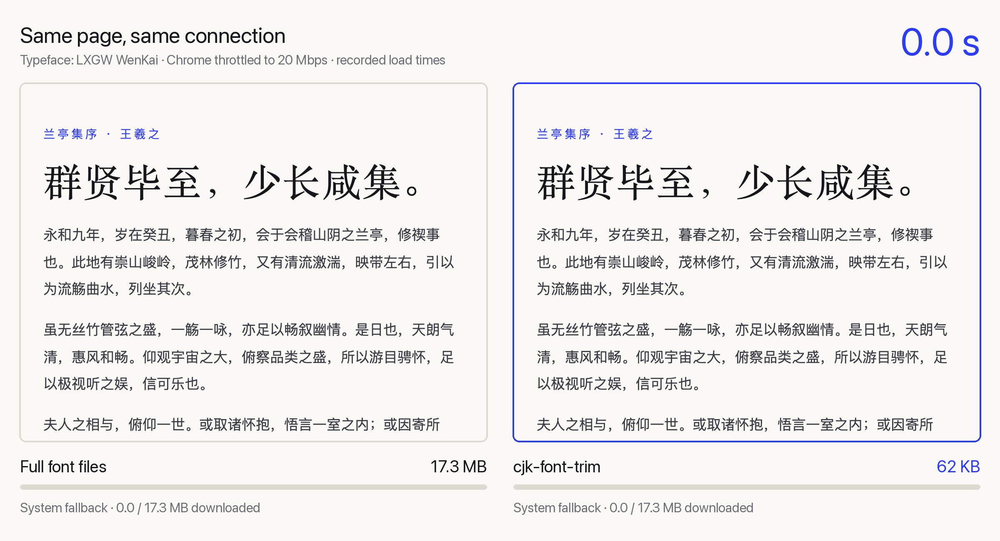
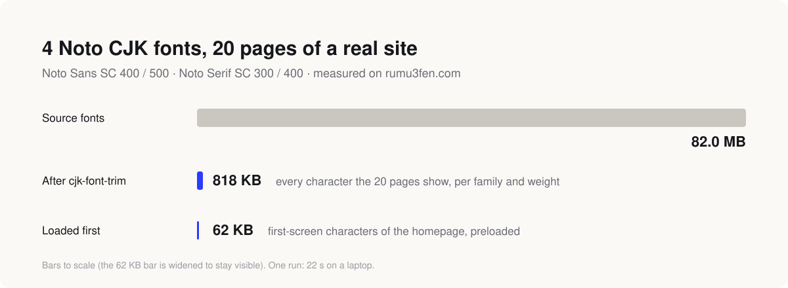
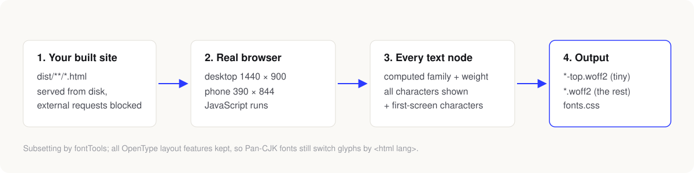
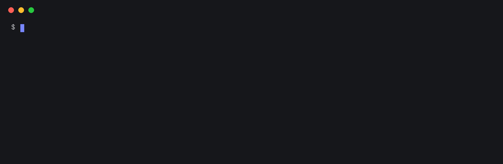

<h1 align="center">cjk-font-trim</h1>

<p align="center">
  <b>Self-host Chinese, Japanese and Korean web fonts at a few hundred KB instead of 20 MB.</b><br>
  Trim each font to the characters your static site actually shows, and load the first screen first.
</p>

<p align="center">
  <a href="LICENSE"></a>
  
  
  
</p>

<p align="center"><b>English</b> · <a href="README.zh-CN.md">简体中文</a> · <a href="README.ja.md">日本語</a></p>

<p align="center"><br><sub>Same page, same throttled connection (Chrome, 20 Mbps). Left: the full LXGW WenKai files, 17.3 MB. Right: cjk-font-trim output. Recorded load times; the final renders are pixel-identical.</sub></p>

## The problem

A Latin web font is 20–50 KB. A CJK font has tens of thousands of glyphs and weighs **16–25 MB per weight**. Your options are usually all bad:

- **Ship the whole font**: nobody waits for 20 MB.
- **Use Google Fonts**: it slices each weight into ~100 `unicode-range` chunks, so a page fires dozens of font requests. And it is blocked in mainland China.
- **Give up and use system fonts**: your carefully chosen typeface only shows up on the designer's machine.

But a typical page only shows a few hundred distinct characters, and a whole marketing site often stays under 2,000.

<p align="center"></p>

## What cjk-font-trim does

1. **Opens every page of your built site in a real browser**, at desktop and phone width, with JavaScript running.
2. **Reads the computed font of every text node**, so it knows which characters appear in which family *and* which weight. Nothing hidden, nothing from the HTML source that never renders.
3. **Writes two `.woff2` files per family/weight**: a tiny **first-screen** file with only what is visible on load, and a second file with everything else.
4. **Writes `fonts.css`**: the first-screen file is declared last with `unicode-range`, so the browser fetches ~10–50 KB before it can paint your hero in the right font, and loads the rest after.

<p align="center"></p>

## When to use it

**Good fit**

- Static or pre-rendered sites: marketing sites, portfolios, docs, blogs, landing pages (Astro, Next.js export, Hugo, Eleventy, Vite, hand-written HTML)
- You want a specific CJK typeface (Noto Serif, Source Han, a licensed brand font) to show up for every visitor
- Your audience includes mainland China, where Google Fonts is not reachable
- Multilingual sites: run once per language

**Not a fit**

- Text you don't know at build time: comments, user names, search boxes, CMS content edited after deploy. Characters outside the subset fall back to the next font in your stack. For that, split the whole font into ordered chunks with [cn-font-split](https://github.com/KonghaYao/cn-font-split) instead.
- Fonts whose license forbids subsetting or self-hosting. (Noto CJK, Source Han and most OFL fonts allow both.)

## Quick start

```bash
git clone https://github.com/rumu3fen-dev/cjk-font-trim && cd cjk-font-trim
pip install -r requirements.txt    # fontTools + brotli
npm install                        # Playwright
npx playwright install chromium    # or add --chrome to use your installed Google Chrome
```

Try it on the bundled one-page [example](example/) first:

<p align="center"></p>

Build your site, then point the tool at the output folder and your source fonts:

```bash
python3 cjk_font_trim.py --site ../my-site/dist --out ../my-site/dist/fonts --url /fonts/ \
  --font "Noto Sans SC:400=fonts/NotoSansCJKsc-Regular.otf" \
  --font "Noto Sans SC:700=fonts/NotoSansCJKsc-Bold.otf" \
  --font "Noto Serif SC:300=fonts/NotoSerifCJKsc-Light.otf"
```

```
scanning 20 page(s) for Noto Sans SC, Noto Serif SC; first screen from / …
  Noto Sans SC 400: 990 chars → noto-sans-sc-400.woff2 269 KB
                   + noto-sans-sc-400-top.woff2 45 KB (151 first-screen chars)
  Noto Sans SC 500: 379 chars → noto-sans-sc-500.woff2 140 KB
  Noto Serif SC 300: 219 chars → noto-serif-sc-300.woff2 140 KB
                    + noto-serif-sc-300-top.woff2 6 KB (10 first-screen chars)
  Noto Serif SC 400: 377 chars → noto-serif-sc-400.woff2 206 KB
                    + noto-serif-sc-400-top.woff2 11 KB (27 first-screen chars)
done: 818 KB of fonts (source: 82.0 MB), rules in ../my-site/dist/fonts/fonts.css
```

Then replace your `@font-face` rules with the generated `fonts.css` and preload the first-screen files:

```html
<link rel="stylesheet" href="/fonts/fonts.css">
<link rel="preload" href="/fonts/noto-sans-sc-400-top.woff2" as="font" type="font/woff2" crossorigin>
```

Keep your CSS as it is: `font-family: "Noto Sans SC", sans-serif` now resolves to the trimmed files. Run the tool again whenever the text changes; it is quick enough to be the last step of your build.

## Options

| option | meaning |
|---|---|
| `--site DIR` | built site folder (required) |
| `--font "FAMILY:WEIGHT=FILE"` | one per family and weight (required, repeatable). `FAMILY` is the name used in your CSS; it can be anywhere in the font stack. `.otf`, `.ttf`, `.woff2` all work |
| `--out DIR` | where to write the `.woff2` files and `fonts.css` (required) |
| `--url PREFIX` | URL the browser loads the fonts from (default `/fonts/`) |
| `--pages / /about/ …` | pages to scan (default: every `.html` file in `--site`) |
| `--top-pages / …` | pages whose first screen goes into the small `*-top` files (default: `/` if scanned, else the first page). Every scanned page still counts toward the full files |
| `--top-exclude "figure,.demo"` | first-screen elements that can wait for the full file (animations, long paragraphs), to keep `*-top` small |
| `--chrome` | use your installed Google Chrome instead of Playwright's Chromium |

Computed weights are folded into the nearest weight you supplied, so a `font-weight: 450` lands on `400` or `500`.

## Compared with other tools

All of these are good tools; they solve neighbouring problems.

| tool | how it finds characters | best for |
|---|---|---|
| **cjk-font-trim** | renders built pages in a browser, desktop + phone | static CJK sites that want per-weight files and a separate first-screen file |
| [glyphhanger](https://github.com/zachleat/glyphhanger) | crawls URLs in a headless browser | analysing `unicode-range` usage and subsetting any font, especially Latin |
| [subfont](https://github.com/Munter/subfont) | traces fonts through your HTML/CSS and rewrites them | a build step that also self-hosts Google Fonts and injects preloads |
| [font-spider 字蛛](https://github.com/aui/font-spider) | static analysis of local HTML and CSS | Chinese pages whose text is all in the HTML source |
| [cn-font-split](https://github.com/KonghaYao/cn-font-split) | doesn't: splits the whole font into ordered chunks | text unknown at build time; any character still works |

None of the others split out a separate first-screen file, which is what makes the hero render in the right font almost immediately.

## FAQ

**Japanese, Korean, Traditional Chinese?** Yes. Pass the matching fonts (`Noto Sans JP`, `Noto Sans KR`, `Noto Sans TC`…). Pan-CJK fonts such as Noto Sans CJK switch glyph shapes by `<html lang>` through OpenType `locl`; all layout features are kept, so one source font can serve several languages. For multilingual sites, run once per language with that language's pages and output folder.

**What happens to a character that isn't in the subset?** The browser uses the next font in your `font-family` stack for that character. ASCII and common CJK punctuation are always included.

**Text that appears after a click (menus, tabs, the next step of a form)?** It's counted if it is in the DOM when the page has loaded, even if hidden. Text fetched later from an API is not.

**Does it upload my site or fonts anywhere?** No. Pages are served from your disk inside the browser, and every external request is blocked during the scan.

**Variable fonts?** Not tested yet. Static weights are the supported case.

## Used by

- [rumu3fen.com](https://rumu3fen.com/en/): four languages (Simplified and Traditional Chinese, Japanese, English) from one set of Noto CJK fonts.

Using it somewhere? Open an issue or PR to add your site.

## Contributing

Issues and pull requests are welcome. The whole tool is two files: `collect.js` (browser scan, prints JSON) and `cjk_font_trim.py` (CLI, subsetting, CSS).

## License

[MIT](LICENSE) © INGRAIN. Made by [入木 INGRAIN](https://rumu3fen.com/en/), who build business systems and data platforms.
