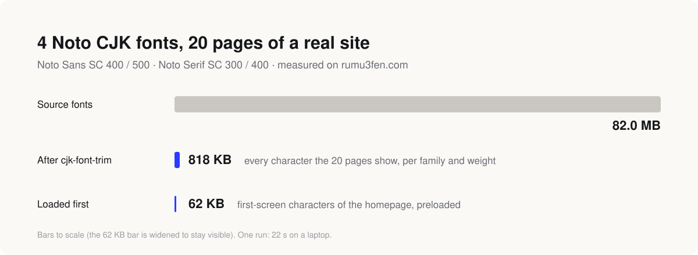
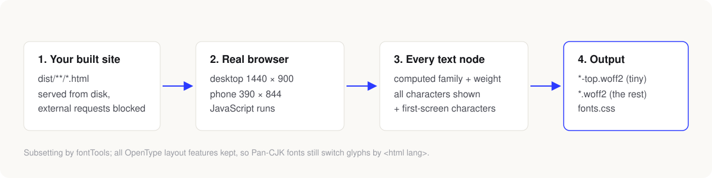

<h1 align="center">cjk-font-trim</h1>

<p align="center">
  <b>中文字体自己托管，从 20 MB 降到几百 KB。</b><br>
  按网站真正显示的字裁剪字体，第一屏的字单独先加载。
</p>

<p align="center">
  <a href="LICENSE"></a>
  
  
  
</p>

<p align="center"><a href="README.md">English</a> · <b>简体中文</b> · <a href="README.ja.md">日本語</a></p>

<p align="center"></p>

## 要解决的问题

一个英文网页字体二三十 KB；一个中文字体有几万个字形，**每个字重 16–25 MB**。常见的几种做法都不理想：

- **整个字体放上去**：没人会等 20 MB 下载完。
- **用 Google Fonts**：它把每个字重切成一百来个 `unicode-range` 小包，一个页面要发几十个字体请求；而且国内打不开。
- **干脆用系统字体**：精心挑的字体，只有设计师自己的电脑上看得到。

可一个页面实际显示的字通常只有几百个，整个官网加起来也常常不到两千个。

## 它做什么

1. **用真实浏览器打开你打包好的每一个页面**，桌面和手机两种宽度各开一遍，页面脚本照常运行。
2. **读取每段文字最终用的字体**，知道哪个字出现在哪个字体、哪个字重里。隐藏的、源码里有但不显示的都不算。
3. **每个字体每个字重输出两个 `.woff2`**：一个很小的**首屏**文件，只含打开页面就看得见的字；另一个放其余的字。
4. **生成 `fonts.css`**：首屏文件声明在最后、带 `unicode-range`，浏览器先下载十几到几十 KB 就能用对的字体显示首屏，其余的随后加载。

<p align="center"></p>

## 什么时候用

**适合**

- 静态或预渲染的网站：官网、作品集、文档、博客、落地页（Astro、Next.js 导出、Hugo、Eleventy、Vite、手写 HTML 都行）
- 想让每个访客都看到指定的中文字体（思源宋体、Noto Serif、买了授权的品牌字体）
- 访客在国内，用不了 Google Fonts
- 多语言网站：每种语言各跑一次

**不适合**

- 打包时还不知道内容的文字：评论、用户名、搜索框、上线后在后台改的内容。裁掉的字会用字体栈里的下一个字体显示。这种情况请用 [cn-font-split](https://github.com/KonghaYao/cn-font-split)，它把整套字体按顺序切成小包，任何字都能显示。
- 授权不允许裁剪或自行托管的字体。（Noto CJK、思源系列和大多数 OFL 字体都允许。）

## 快速开始

```bash
git clone https://github.com/rumu3fen-dev/cjk-font-trim && cd cjk-font-trim
pip install -r requirements.txt    # fontTools + brotli
npm install                        # Playwright
npx playwright install chromium    # 或者加 --chrome 用本机装的 Google Chrome
```

先打包网站，再把输出目录和字体原文件交给它：

```bash
python3 cjk_font_trim.py --site ../my-site/dist --out ../my-site/dist/fonts --url /fonts/ \
  --font "Noto Sans SC:400=fonts/NotoSansCJKsc-Regular.otf" \
  --font "Noto Sans SC:700=fonts/NotoSansCJKsc-Bold.otf" \
  --font "Noto Serif SC:300=fonts/NotoSerifCJKsc-Light.otf"
```

```
scanning 20 page(s) for Noto Sans SC, Noto Serif SC; first screen from / …
  Noto Sans SC 400: 990 chars → noto-sans-sc-400.woff2 269 KB + noto-sans-sc-400-top.woff2 45 KB (151 first-screen chars)
  Noto Sans SC 500: 379 chars → noto-sans-sc-500.woff2 140 KB
  Noto Serif SC 300: 219 chars → noto-serif-sc-300.woff2 140 KB + noto-serif-sc-300-top.woff2 6 KB (10 first-screen chars)
  Noto Serif SC 400: 377 chars → noto-serif-sc-400.woff2 206 KB + noto-serif-sc-400-top.woff2 11 KB (27 first-screen chars)
done: 818 KB of fonts
```

然后用生成的 `fonts.css` 换掉原来的 `@font-face`，并预加载首屏文件：

```html
<link rel="stylesheet" href="/fonts/fonts.css">
<link rel="preload" href="/fonts/noto-sans-sc-400-top.woff2" as="font" type="font/woff2" crossorigin>
```

原来的 CSS 不用改，`font-family: "Noto Sans SC", sans-serif` 会自动用上裁好的文件。文字有改动就重新跑一次，速度够快，可以直接放在打包流程的最后一步。

## 参数

| 参数 | 说明 |
|---|---|
| `--site 目录` | 打包好的网站目录（必填） |
| `--font "字体名:字重=文件"` | 每个字体每个字重一条（必填，可重复）。字体名就是 CSS 里 `font-family` 写的名字，写在字体栈哪个位置都行。支持 `.otf`、`.ttf`、`.woff2` |
| `--out 目录` | `.woff2` 和 `fonts.css` 的输出目录（必填） |
| `--url 前缀` | 浏览器加载字体的网址前缀（默认 `/fonts/`） |
| `--pages / /about/ …` | 要扫描的页面（默认 `--site` 下所有 `.html`） |
| `--top-pages / …` | 哪些页面的首屏放进小的 `*-top` 文件（默认首页 `/`；没扫首页就用第一个页面）。其他页面的字照样算进完整文件 |
| `--top-exclude "figure,.demo"` | 首屏里可以等完整文件的元素（动画、长段落），让 `*-top` 更小 |
| `--chrome` | 用本机装的 Google Chrome，不用 Playwright 自带的 Chromium |

浏览器算出来的字重会归到你提供的最接近的字重，比如 `font-weight: 450` 会归到 400 或 500。

## 和其他工具比

下面这些都是好工具，各自解决相邻的问题。

| 工具 | 怎么统计用到的字 | 最适合 |
|---|---|---|
| **cjk-font-trim** | 浏览器渲染打包好的页面，桌面 + 手机 | 静态中文网站，要按字重出文件，并单独拆出首屏文件 |
| [glyphhanger](https://github.com/zachleat/glyphhanger) | 无头浏览器爬网址 | 分析 `unicode-range` 用量、裁剪各种字体，尤其是西文 |
| [subfont](https://github.com/Munter/subfont) | 顺着 HTML/CSS 追踪字体并改写 | 作为打包步骤，顺带把 Google Fonts 转成自托管并加预加载 |
| [font-spider 字蛛](https://github.com/aui/font-spider) | 静态分析本地 HTML 和 CSS | 文字都写在 HTML 源码里的中文页面 |
| [cn-font-split](https://github.com/KonghaYao/cn-font-split) | 不统计：把整套字体按顺序切包 | 打包时不知道内容的文字，任何字都能显示 |

其他几个都不会单独拆出首屏文件，而首屏能几乎立刻用对字体显示，靠的就是这一步。

## 常见问题

**日文、韩文、繁体中文能用吗？** 能，传对应的字体就行（`Noto Sans JP`、`Noto Sans KR`、`Noto Sans TC`……）。Noto Sans CJK 这类泛中日韩字体会按 `<html lang>` 通过 OpenType `locl` 切换字形，裁剪时保留了全部排版特性，所以同一个字体文件可以同时服务几种语言。多语言网站按语言各跑一次，用各自的页面和输出目录。

**子集里没有的字会怎样？** 浏览器会用 `font-family` 字体栈里的下一个字体显示那个字。ASCII 和常用中文标点总是包含在内。

**点击后才出现的文字（菜单、标签页、表单的下一步）？** 只要页面加载完时已经在 DOM 里，哪怕是隐藏的，也会算进去。之后再从接口拉来的文字不算。

**会把我的网站或字体上传到哪里吗？** 不会。页面在浏览器里直接从你的硬盘读取，扫描期间所有外部请求都被拦掉。

**可变字体？** 还没测过，目前支持的是普通的分字重字体。

## 谁在用

- [rumu3fen.com](https://rumu3fen.com/)：简体、繁体、日文、英文四种语言，共用一套 Noto CJK 字体。

你也在用？欢迎提 issue 或 PR 把你的网站加进来。

## 参与贡献

欢迎提 issue 和 PR。整个工具只有两个文件：`collect.js`（浏览器扫描，输出 JSON）和 `cjk_font_trim.py`（命令行、裁剪、生成 CSS）。

## 许可证

[MIT](LICENSE) © INGRAIN。由[入木 INGRAIN](https://rumu3fen.com/) 制作。入木为机构和企业做数据平台和业务系统。
